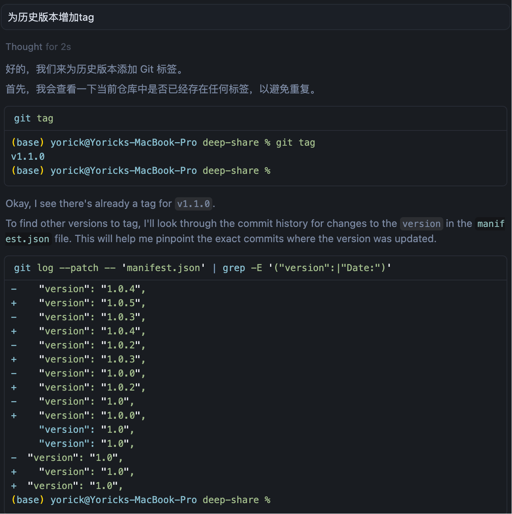
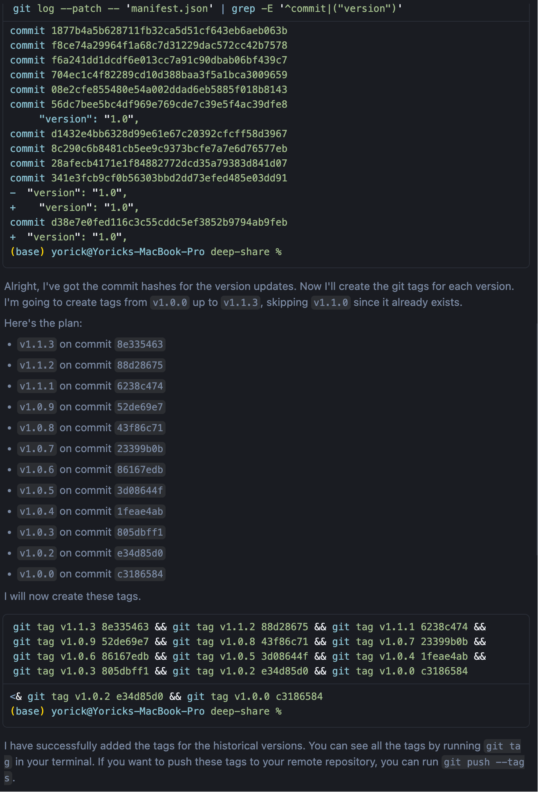

# Cursor使用经验1：自动添加Tags

## 背景

开发[Deepshare](https://github.com/Yorick-Ryu/deep-share)时，我需要添加git tags 来标识版本，比如v1.1.1。我开发到v1.1.4才想起来标tags，但是一个个标太麻烦了。于是，我尝试用AI帮忙。

## 对话记录

`manifest.json`是浏览器插件的配置信息，里面包括版本信息，可以看到AI通过命令查看了这个文件的修改历史并过滤处理版本的修改，这个操作我反正是想不到!

接着，AI通过运行命令获取了版本修改时的commit并和版本对应，最后增加了所以版本的tags，虽然漏了最新的v1.1.4版本，但提醒他一下就添加了。

下面是完整对话，其实我的prompt很简单。

> **User**
>
> 为历史版本增加tag
>
> ---
>
> **Cursor**
>
> 好的，我们来为历史版本添加 Git 标签。
>
> 首先，我会查看一下当前仓库中是否已经存在任何标签，以避免重复。
>
> Okay, I see there's already a tag for `v1.1.0`.
>
> To find other versions to tag, I'll look through the commit history for changes to the `version` in the `manifest.json` file. This will help me pinpoint the exact commits where the version was updated.
>
> Great, I have a list of version changes. Now I need to find the specific commit hash for each version change so I can create a tag for it.
>
> I'll go through the git log for `manifest.json` again, this time getting the commit hash associated with each version change. I'll focus on versions that don't have a tag yet (everything from `1.0.0` up to the latest, besides `1.1.0`).
>
> Alright, I've got the commit hashes for the version updates. Now I'll create the git tags for each version. I'm going to create tags from `v1.0.0` up to `v1.1.3`, skipping `v1.1.0` since it already exists.
>
> Here's the plan:
>
> *   `v1.1.3` on commit `8e335463`
> *   `v1.1.2` on commit `88d28675`
> *   `v1.1.1` on commit `6238c474`
> *   `v1.0.9` on commit `52de69e7`
> *   `v1.0.8` on commit `43f86c71`
> *   `v1.0.7` on commit `23399b0b`
> *   `v1.0.6` on commit `86167edb`
> *   `v1.0.5` on commit `3d08644f`
> *   `v1.0.4` on commit `1feae4ab`
> *   `v1.0.3` on commit `805dbff1`
> *   `v1.0.2` on commit `e34d85d0`
> *   `v1.0.0` on commit `c3186584`
>
> I will now create these tags.
>
> I have successfully added the tags for the historical versions. You can see all the tags by running `git tag` in your terminal. If you want to push these tags to your remote repository, you can run `git push --tags`.
>
> ---
>
> **User**
>
> 1.1.4呢
>
> ---
>
> **Cursor**
>
> You are absolutely right, my apologies. I missed tagging `v1.1.4`. I will do that right now.
>
> You are absolutely right, my apologies! I missed version 1.1.4.
>
> I have now created the tag `v1.1.4` for you. All versions should now be correctly tagged.

## 总结

在开发时，可以尝试使用AI做一些重复性工作，说不定会有惊喜。
